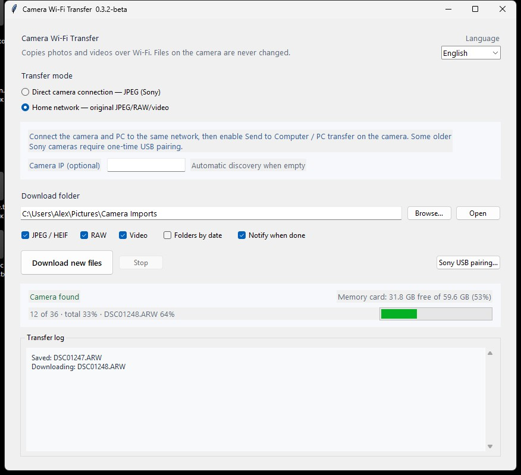

# Camera Wi-Fi Transfer

[](https://github.com/dykomenko/camera-wifi-transfer/releases)
[](https://github.com/dykomenko/camera-wifi-transfer/actions/workflows/windows-build.yml)
[](README.md)
[](README.md)
[](LICENSE)

[Русский](README_RU.md)

**Camera Wi-Fi Transfer is a Windows desktop application with a graphical interface** for importing photos, RAW files, and videos from compatible cameras over Wi-Fi—without requiring the manufacturer's desktop importer.



## Why it exists

Camera companion apps are often slow, unreliable, or phone-first. Camera Wi-Fi Transfer provides a small, understandable Windows GUI that works with a wired PC and a camera connected to the same router.

## Features

- Native Windows GUI: mode, destination, filters, progress, and readable log
- Clean per-file status plus an overall `current / total` progress bar
- Card capacity and free-space display when the camera reports it
- Optional completion notification with download and skip counts
- Automatic PTP/IP discovery on the real LAN adapter, even with VirtualBox or Hyper-V installed
- Optional manual camera IP for devices that do not answer discovery
- Original JPEG/HEIF, common RAW formats, and video files
- Sony direct-camera JPEG mode
- Safe one-time USB pairing for older Sony cameras with a `PMHOME` service volume
- Automatic Russian/English UI based on Windows, with a manual language selector
- User-controlled and persistent destination, file types, mode, and date folders
- `.part` downloads and atomic completion; existing files are not overwritten
- No photo deletion and no USB driver replacement

## Compatibility

The app is model-independent, but a camera must expose a supported network transport.

| Mode | Expected cameras | Result |
|---|---|---|
| Home network, PTP/IP | Compatible Sony/Canon and other suitable PTP/IP cameras | Original JPEG/HEIF, RAW, video |
| Direct camera network | Sony cameras exposing `Send to Smartphone` / XPush | JPEG; camera converts RAW to JPEG |
| USB pairing helper | Sony cameras exposing the `PMHOME` service volume | Registers the PC only; does not transfer or modify media over USB |

End-to-end verified on **Sony ILCE-6500 (a6500)**: native Windows USB pairing, discovery from an Ethernet-only PC through a router, PTP/IP connection, and ARW download. Support cannot be guaranteed solely from a model name; please open an issue with results for additional cameras.

## Quick start

1. Download and extract the latest ZIP from [Releases](../../releases/latest).
2. Run `Camera WiFi Transfer.exe`.
3. Choose a destination and file types.
4. Enable `Send to Computer`, `PC transfer`, or the equivalent mode on the camera.
5. Click **Download new files**.

Settings are stored per Windows user in:

```text
%LOCALAPPDATA%\CameraWiFiTransfer\settings.json
```

For older Sony cameras, run **Sony USB pairing…** once first. Keep the normal Windows Mass Storage driver installed.

## Safety model

- The app reads media but does not delete or modify it on the camera.
- Downloads are written to `.part` and atomically renamed only after completion.
- The Sony pairing helper verifies `SONY DSC` and the `PMHOME` service volume.
- Pairing uses the standard Windows `USBSTOR` stack via SCSI pass-through.
- Zadig, WinUSB, libusbK, UsbDk, and filesystem-sector writes are not used.

Deletion is intentionally not exposed: generic MTP `DeleteObject` does not guarantee that an older camera's proprietary image database is updated correctly. Delete files with the camera's own menu after verifying the local copies.

## Build from source

Python 3.10+ and PyInstaller are sufficient:

```powershell
python -m unittest discover -s tests -v
python -m pip install pyinstaller
powershell -ExecutionPolicy Bypass -File scripts/build.ps1
```

The portable ZIP is written to `artifacts`.

## Contributing

Camera test reports are especially useful. Include the model, transfer mode, whether discovery worked automatically, and the non-sensitive portion of the transfer log. Never upload photos, credentials, Wi-Fi passwords, or full private network logs.

## License and credits

GPL-3.0. The PTP/IP backend is based on [airMTP](https://github.com/shezi/airmtp); Sony direct transfer follows the reverse-engineered XPush/UPnP behavior; native USB pairing follows the Windows SCSI pass-through approach demonstrated by [Sony-PMCA-RE](https://github.com/ma1co/Sony-PMCA-RE). See [THIRD_PARTY_NOTICES.md](THIRD_PARTY_NOTICES.md).
