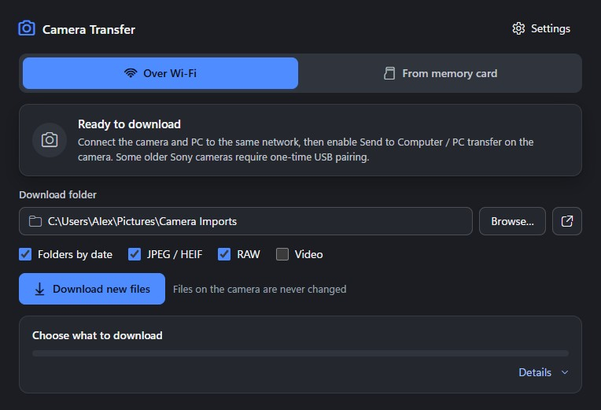

# Camera Transfer (Camera Wi-Fi Transfer)

[](https://github.com/dykomenko/camera-wifi-transfer/releases)
[](https://github.com/dykomenko/camera-wifi-transfer/actions/workflows/windows-build.yml)
[](README.md)
[](README.md)
[](LICENSE)

[Русский](README_RU.md)

**Camera Transfer is a Windows desktop application** for importing photos, RAW (ARW) files, and videos from Sony Alpha and other compatible cameras over Wi-Fi, and for moving everything off a Sony memory card in a card reader without breaking the camera's database—without requiring the manufacturer's desktop importer. It is a lightweight alternative to the Wi-Fi Import of Sony PlayMemories Home, using the camera's **Send to Computer** mode.



## Why it exists

Camera companion apps are often slow, unreliable, or phone-first. Camera Transfer is one small, understandable window: one tab downloads over Wi-Fi from a camera on the same router, the other empties a memory card in the card reader.

## Features

- One modern window with two tabs, **Over Wi-Fi** and **From memory card**; follows the Windows light/dark theme
- Switches to the memory-card tab by itself when a Sony card is inserted
- Rarely used options (camera IP, direct mode, USB pairing, start-up behaviour) live in Settings; the log is folded under Details
- Clean per-file status plus an overall `current / total` progress bar
- Card capacity and free-space display when the camera reports it
- Optional completion notification with download and skip counts
- Automatic PTP/IP discovery on the real LAN adapter, even with VirtualBox or Hyper-V installed
- Optional manual camera IP for devices that do not answer discovery
- Original JPEG/HEIF, common RAW formats, and video files
- Sony direct-camera JPEG mode
- Safe one-time USB pairing for older Sony cameras with a `PMHOME` service volume
- UI in English, Russian, Belarusian, Ukrainian, Polish, German, French, Spanish, Italian, Portuguese, Chinese and Japanese — picked from the Windows language, with a manual selector
- User-controlled and persistent destination, file types, mode, and date folders
- `.part` downloads and atomic completion; existing files are not overwritten
- No photo deletion and no USB driver replacement

## Compatibility

The app is model-independent, but a camera must expose a supported network transport.

| Mode | Expected cameras | Result |
|---|---|---|
| Home network, PTP/IP | Compatible Sony/Canon and other suitable PTP/IP cameras | Original JPEG/HEIF, RAW, video |
| Direct camera network | Sony cameras exposing `Send to Smartphone` / XPush | JPEG; camera converts RAW to JPEG |
| USB pairing helper | Sony cameras exposing the `PMHOME` service volume | Registers the PC only; does not transfer or modify media over USB |

End-to-end verified on **Sony ILCE-6500 (a6500)**: native Windows USB pairing, discovery from an Ethernet-only PC through a router, PTP/IP connection, and ARW download. Support cannot be guaranteed solely from a model name; please open an issue with results for additional cameras.

## Camera models

**Tested: Sony a6500 (ILCE-6500) only.** Every other model below is listed because it has the same **Send to Computer** Wi-Fi mode that the app relies on — it should work, but has not been tested.

| Series | Models (not tested) |
|---|---|
| Sony a6000 line | a6000 (ILCE-6000), a6100 (ILCE-6100), a6300 (ILCE-6300), a6400 (ILCE-6400), a6600 (ILCE-6600) |
| Sony a5000 / NEX | a5000 (ILCE-5000), a5100 (ILCE-5100), NEX-5R, NEX-5T, NEX-6 |
| Sony full frame | a7 II (ILCE-7M2), a7R II (ILCE-7RM2), a7S II (ILCE-7SM2), a7 III (ILCE-7M3), a7R III (ILCE-7RM3), a9 (ILCE-9) |
| Sony compacts | RX100 III–VII (DSC-RX100M3…M7), RX10 II–IV (DSC-RX10M2…M4) |

Canon EOS and Nikon cameras with built-in Wi-Fi are supported by the underlying airMTP backend but are untested with this app; Nikon needs the manual camera IP. Cameras without **Send to Computer** (some newer bodies offer only FTP or app-based transfer) cannot use the home-network mode.

If you try another model, please report the result in an issue.

## Moving a memory card (From memory card tab)

The **From memory card** tab moves **everything** off a Sony camera memory card in a card reader: photos and XAVC S clips. Deleting files from a camera card on a PC normally leaves the camera's own image database (`AVF_INFO`) pointing at missing files, and the camera then reports a database error. Camera Transfer updates that database the way the camera does when it deletes images itself, so the camera shows no error and needs no "Recover Image DB" or formatting.

- Finds the card even when Windows gave it no drive letter.
- Changes nothing unless the card has the Sony layout, its database validates, and the files on the card match it exactly.
- Copies every file through a `.part` file and checks each copy against the original by SHA-256 before anything is removed.
- Backs up the card's database files to `%LOCALAPPDATA%\CameraCardMover\card-database-backups` first.
- Moves by a button press; optionally starts with Windows in the background and opens when a card is inserted.
- Only "move everything" is offered: a partial move would need database fields that are not fully understood yet.

Verified on a **Sony a6500** card: after a move the camera showed no error and recorded new photos normally. Other Sony models with the same `AVF_INFO` database should work but are untested; cards whose database is not recognised are left untouched. Format notes: [docs/sony-image-database.md](docs/sony-image-database.md).

## Quick start

1. Download and extract the latest ZIP from [Releases](../../releases/latest).
2. Run `Camera Transfer.exe` (keep `airmtp-backend.exe` next to it).
3. **Over Wi-Fi:** enable `Send to Computer`, `PC transfer`, or the equivalent mode on the camera; the download starts by itself (or click **Download new files**).
4. **From memory card:** insert the camera's card into the card reader and click **Move everything to the PC**.

The window uses Microsoft Edge WebView2, which is part of Windows 11 and installed on most Windows 10 PCs.

Settings are stored per Windows user in:

```text
%LOCALAPPDATA%\CameraWiFiTransfer\settings.json
```

For older Sony cameras, run **Sony USB pairing…** once first. Keep the normal Windows Mass Storage driver installed.

## Safety model

- The app reads media but does not delete or modify it on the camera.
- Downloads are written to `.part` and atomically renamed only after completion.
- The Sony pairing helper verifies `SONY DSC` and the `PMHOME` service volume.
- Pairing uses the standard Windows `USBSTOR` stack via SCSI pass-through.
- Zadig, WinUSB, libusbK, UsbDk, and filesystem-sector writes are not used.

Deletion is intentionally not exposed: generic MTP `DeleteObject` does not guarantee that an older camera's proprietary image database is updated correctly. Delete files with the camera's own menu after verifying the local copies.

## Build from source

Python 3.10+ and PyInstaller are sufficient:

```powershell
python -m unittest discover -s tests -v
python -m pip install pyinstaller
powershell -ExecutionPolicy Bypass -File scripts/build.ps1
```

The portable ZIP is written to `artifacts`.

## Contributing

Camera test reports are especially useful. Include the model, transfer mode, whether discovery worked automatically, and the non-sensitive portion of the transfer log. Never upload photos, credentials, Wi-Fi passwords, or full private network logs.

## Keywords

Sony a6500 Wi-Fi transfer to PC · Sony Alpha wireless import on Windows · Send to Computer · PlayMemories Home Wi-Fi Import alternative · PlayMemories Home Wi-Fi Import not working · download ARW RAW over Wi-Fi · camera to PC without a USB cable · PTP/IP · MTP over Wi-Fi · ILCE-6000 · ILCE-6300 · ILCE-6400 · ILCE-6500 · ILCE-7M3

## License and credits

GPL-3.0. The PTP/IP backend is based on [airMTP](https://github.com/shezi/airmtp); Sony direct transfer follows the reverse-engineered XPush/UPnP behavior; native USB pairing follows the Windows SCSI pass-through approach demonstrated by [Sony-PMCA-RE](https://github.com/ma1co/Sony-PMCA-RE). See [THIRD_PARTY_NOTICES.md](THIRD_PARTY_NOTICES.md).
