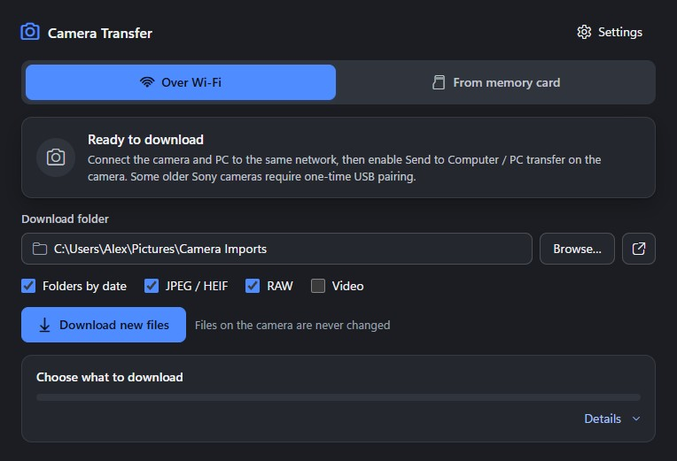

# Camera Wi-Fi Transfer

[English](README.md) · Windows 10/11 · GPL-3.0

**Camera Transfer — программа для Windows**, которая копирует фото, RAW (ARW) и видео с Sony Alpha и других совместимых камер по Wi-Fi, а также переносит всё с карты памяти Sony в кардридере, не ломая базу камеры. Фирменный импортёр не нужен. Это лёгкая замена Wi-Fi-импорту из Sony PlayMemories Home: используется режим камеры **«Отправить на компьютер»** (Send to Computer).



## Возможности

- одно современное окно с двумя вкладками — **«По Wi-Fi»** и **«С карты памяти»**, светлая или тёмная тема как в Windows;
- при вставке карты Sony программа сама переключается на вкладку карты;
- редкие настройки (IP камеры, прямой режим, USB-привязка, автозапуск) — в «Настройках», журнал свёрнут в «Подробности»;
- аккуратный прогресс текущего файла и общий счётчик `готово / всего`;
- объём и свободное место на карте, если камера сообщает эти данные;
- отдельное уведомление после полного завершения копирования;
- автоматический поиск камеры в домашней сети через PTP/IP;
- ручной IP для камер, которые не отвечают на поиск;
- оригинальные JPEG/HEIF, распространённые RAW и видеоформаты;
- прямой JPEG-режим для совместимых Sony;
- безопасная однократная USB-привязка для старых Sony с томом `PMHOME`;
- интерфейс на русском, белорусском, украинском, английском, польском, немецком, французском, испанском, итальянском, португальском, китайском и японском — по языку Windows, плюс ручной переключатель;
- выбранная папка и остальные параметры запоминаются;
- готовый файл появляется только после полной загрузки, существующие файлы не перезаписываются.

## Совместимость

Программа больше не привязана к конкретной модели. Она работает с камерами, которые предоставляют один из поддерживаемых сетевых режимов:

| Режим | Камеры | Что передаётся |
|---|---|---|
| Домашняя сеть, PTP/IP | Совместимые Sony/Canon и другие камеры с подходящим PTP/IP | Оригинальные JPEG/HEIF, RAW, видео |
| Прямая сеть камеры | Sony с `Send to Smartphone` / XPush | JPEG; RAW преобразуется камерой в JPEG |
| USB-привязка | Sony с сервисным томом `PMHOME` | Только регистрация ПК; файлы не копируются по USB |

Полностью проверено на **Sony ILCE-6500 (a6500)**: USB-привязка, обнаружение через проводной ПК и роутер, PTP/IP и загрузка ARW. Поддержка любой камеры не может быть гарантирована только по названию модели — нужен соответствующий сетевой режим. Отчёты о проверенных моделях приветствуются.

## Модели камер

**Протестировано только на Sony a6500 (ILCE-6500).** Остальные модели ниже указаны потому, что у них есть тот же Wi-Fi-режим **«Отправить на компьютер»** (Send to Computer), на котором работает программа, — они должны подойти, но не проверялись.

| Серия | Модели (не проверены) |
|---|---|
| Sony a6000 | a6000 (ILCE-6000), a6100 (ILCE-6100), a6300 (ILCE-6300), a6400 (ILCE-6400), a6600 (ILCE-6600) |
| Sony a5000 / NEX | a5000 (ILCE-5000), a5100 (ILCE-5100), NEX-5R, NEX-5T, NEX-6 |
| Sony полный кадр | a7 II (ILCE-7M2), a7R II (ILCE-7RM2), a7S II (ILCE-7SM2), a7 III (ILCE-7M3), a7R III (ILCE-7RM3), a9 (ILCE-9) |
| Sony компакты | RX100 III–VII (DSC-RX100M3…M7), RX10 II–IV (DSC-RX10M2…M4) |

Canon EOS и Nikon со встроенным Wi-Fi поддерживаются backend'ом airMTP, но с этой программой не проверялись; для Nikon нужно указать IP камеры вручную. Камеры без режима **«Отправить на компьютер»** (часть новых моделей умеет только FTP или передачу через приложение) в режиме домашней сети работать не будут.

Если проверите другую модель — напишите результат в issue.

## Перенос с карты памяти (вкладка «С карты памяти»)

Вкладка **«С карты памяти»** переносит **всё** с карты памяти камеры Sony, вставленной в кардридер: фото и видео XAVC S. Если удалить файлы с карты камеры на компьютере, собственная база снимков камеры (`AVF_INFO`) продолжает ссылаться на них, и камера сообщает об ошибке базы. Camera Transfer правит эту базу так же, как это делает сама камера при удалении, поэтому камера не показывает ошибок и не требует «Восстановить БД» или форматирования.

- Находит карту, даже если Windows не назначила ей букву диска.
- Ничего не меняет, если на карте не структура Sony, база не проходит проверку или файлы на карте не совпадают с базой.
- Копирует каждый файл через `.part` и сверяет каждую копию с оригиналом по SHA-256, прежде чем что-то удалить.
- Сначала сохраняет копию базы карты в `%LOCALAPPDATA%\CameraCardMover\card-database-backups`.
- Перенос по кнопке; по желанию программа запускается с Windows в фоне и открывается при вставке карты.
- Доступен только перенос всего содержимого: для частичного нужны поля базы, которые ещё не до конца разобраны.

Проверено на карте **Sony a6500**: после переноса камера не показала ошибок и нормально записала новые снимки. Другие Sony с такой же базой `AVF_INFO` должны подойти, но не проверялись; карты с незнакомой базой программа не трогает. Описание формата: [docs/sony-image-database.md](docs/sony-image-database.md).

## Быстрый запуск

1. Скачайте ZIP из [Releases](../../releases/latest) и распакуйте его.
2. Запустите `Camera Transfer.exe` (рядом должен лежать `airmtp-backend.exe`).
3. **По Wi-Fi:** включите на камере `Send to Computer`, `PC transfer` или аналогичный режим — скачивание начнётся само (или нажмите **«Скачать новые»**).
4. **С карты памяти:** вставьте карту камеры в кардридер и нажмите **«Перенести всё на ПК»**.

Окно использует Microsoft Edge WebView2 — он встроен в Windows 11 и установлен на большинстве ПК с Windows 10.

Настройки текущего пользователя Windows хранятся здесь:

```text
%LOCALAPPDATA%\CameraWiFiTransfer\settings.json
```

Для старых Sony сначала откройте **«USB-привязка Sony…»**. Драйверы заменять не нужно.

## Безопасность

- программа читает файлы с камеры, но не удаляет и не изменяет их;
- загрузка идёт во временный `.part`, затем выполняется атомарное переименование;
- USB-привязка работает через штатный `USBSTOR` Windows и проверяет `SONY DSC` / `PMHOME`;
- Zadig, WinUSB, libusbK и другие замены драйвера не используются.

Удаление намеренно не добавлено: стандартная команда MTP `DeleteObject` не гарантирует правильное обновление внутренней базы снимков старой камеры. Удаляйте кадры через меню камеры после проверки локальных копий.

## Сборка

Нужны Python 3.10+ и PyInstaller:

```powershell
python -m unittest discover -s tests -v
python -m pip install pyinstaller
powershell -ExecutionPolicy Bypass -File scripts/build.ps1
```

Готовый ZIP появится в `artifacts`.

## Ключевые слова

перенос фото с Sony a6500 на компьютер по Wi-Fi · беспроводной импорт с Sony Alpha в Windows · «Отправить на компьютер» · Send to Computer · замена PlayMemories Home · PlayMemories Home не видит камеру по Wi-Fi · скачать RAW (ARW) с камеры по Wi-Fi · фото с камеры на ПК без кабеля · PTP/IP · ILCE-6000 · ILCE-6300 · ILCE-6400 · ILCE-6500 · ILCE-7M3

## Лицензия и благодарности

Проект распространяется по GPL-3.0. PTP/IP-backend основан на [airMTP](https://github.com/shezi/airmtp), прямой Sony-режим — на исследованном XPush/UPnP-протоколе, а безопасная USB-привязка использует подход Windows SCSI pass-through, показанный в [Sony-PMCA-RE](https://github.com/ma1co/Sony-PMCA-RE). Полные сведения находятся в [THIRD_PARTY_NOTICES.md](THIRD_PARTY_NOTICES.md).
